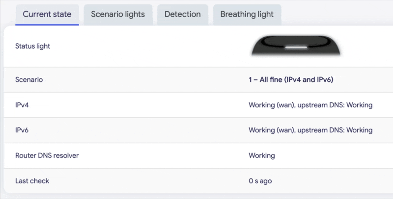
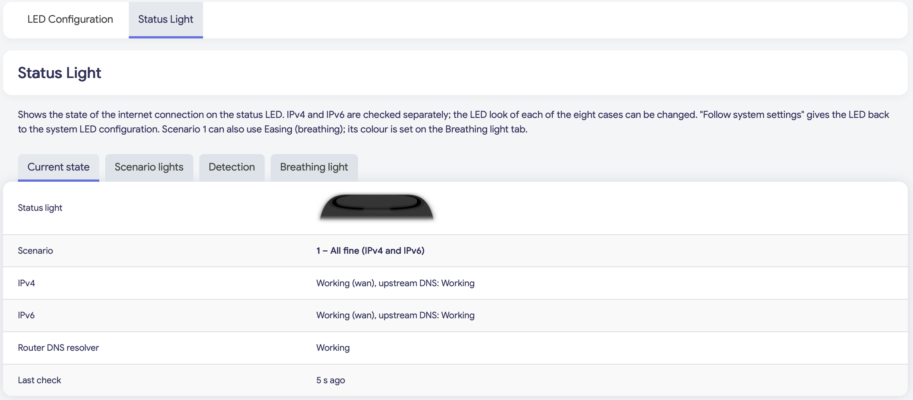
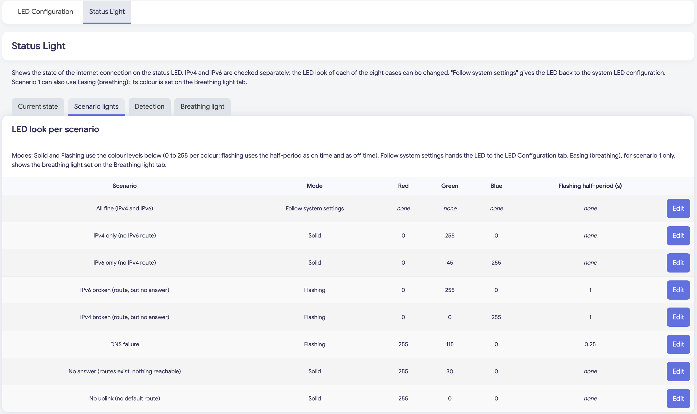
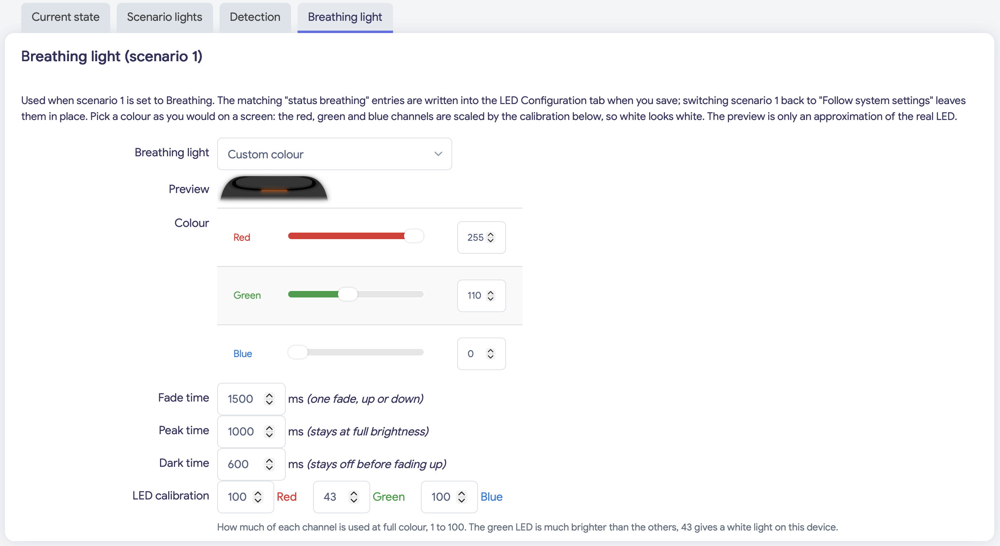
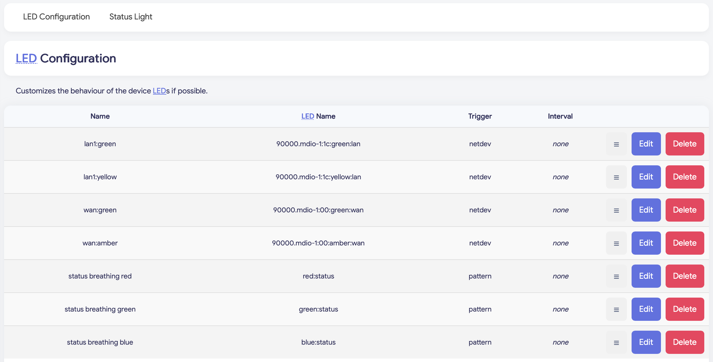

# luci-app-status-light

Internet status on the RGB status LED of the Askey/Spectrum SBE1V1K, with a LuCI page
(System > LED Configuration > Status Light). Self-use package, built for my own firmware.

## What it does

A small daemon (`status-light`) checks IPv4, IPv6 and DNS on their own and shows one of
eight cases on the status LED. Each case has its own look (Solid, Flashing, Follow system
settings; scenario 1 can also be Easing (breathing)); the page has four tabs:

- Current state: the LED as it is now, and what the last check found
- Scenario lights: the look of the eight cases
- Detection: intervals, which servers are checked, DNS checks
- Breathing light: colour, timing and white balance of the breathing light (shown when
  scenario 1 is set to Easing, or when the breathing entries already exist)

The state is written to `/tmp/status-light.json`, the settings are in `/etc/config/status_light`.

## Screenshots

The page in the Argon theme. The breathing light is easier to judge on the router than in a
picture; the preview on the page is only an approximation of the real LED.

| Current state | Scenario lights |
| --- | --- |
|  |  |

## What is checked

IPv4 and IPv6 are probed on their own, together with the router's own DNS resolver. By default
(Servers to check: Automatic) the targets are the DNS servers the WAN interface received
(DHCP, RA or PPP), pinged and asked directly, so it works in any country. For an address
family the WAN has no DNS server for, and with Servers to check set to Custom, the lists on the
Detection tab are used; they ship with public servers (1.1.1.1, 8.8.8.8 and their IPv6
addresses) and can be replaced with servers close to you.

## Other programs and devices

- Another program that drives the `red:status`, `green:status` and `blue:status` LEDs works
  against this one; run only one of them.
- Tested on the SBE1V1K only. Its sibling EBE1V1K has the same LEDs and should work too; I have
  not tried it. The front LED of the CBE1V1K is on I2C without a kernel driver, so it cannot be
  used there.

## Needs in the firmware

- `kmod-ledtrig-pattern` (the pattern LED trigger; the package depends on it)
- the pattern hook for `/etc/init.d/led` and `led-pattern-sync`
  (`/usr/libexec/led-trigger/pattern`, `/usr/libexec/led-pattern-sync`), see sync-bot patch 0008
- `ip-full` (installed with the package)

The package also puts a form for the "pattern" trigger into the LED Configuration page
(`view/system/led-trigger/pattern.js`). LuCI has none; it is copied there only when the file does
not exist, so it never conflicts with one that LuCI may ship later.

## Picture of the device

The Current state and Breathing light tabs show a picture of the device with the light laid
over it (`device.png`, drawn for this package). Without the picture an icon is shown.
